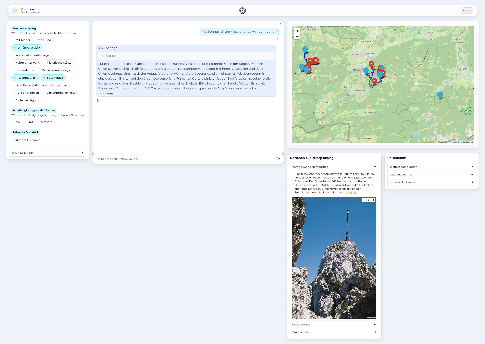

🇩🇪 Deutsch | [🇬🇧 English](README_en.md)

# Agentische KI-Reiseassistenz

> [!IMPORTANT]
> Dies ist eine Proof-of-Concept-Umsetzung einer KI-gestützten Reise- und Wanderassistenz. Sie nutzt ein agentisches KI-System mit mehreren Tools, um Nutzerinnen und Nutzer bei ihren Reise- und Wanderplanungen zu unterstützen.

> [!WARNING]
> Bei diesem Prototyp handelt es sich nicht um produktionsreifen Programmcode. Es handelt sich um einen Forschungsprototypen, der die Fähigkeiten von LLMs und agentischen Systemen im Kontext von Reise- und Wanderpublishern demonstriert. Nutzung auf eigene Gefahr.



## Erste Schritte mit Docker

* Sicherstellen, dass Docker und Docker-Compose auf der gewünschten Plattform installiert sind.
* Installation von uv: https://docs.astral.sh/uv/getting-started/installation/
* Klonen des Repositories.
* Ablegen der Reise- und Wanderdaten im Verzeichnis `data/`.
* Projektabhängigkeiten installieren: `uv sync`.
* Umgebungsdatei erstellen `.env`, durch kopieren und anpassen von `env.template`.
* Datenbank einrichten: `make db`.
* Docker-Image bauen und starten:
```bash
docker compose build
docker compose up -d
```

Die Anwendung ist anschließend unter `127.0.0.1:8887` verfügbar.

## Eigene Daten laden

Wir liefern den Prototypen mit einem Beispieldatensatz aus, um die Nutzung mit verschiedenen Datentypen zu demonstrieren. Diese liegen in `data/example/`. Dies kann als Ausgangspunkt für eigene Daten verwendet werden.

## Tools anpassen

Der Prototyp benötigt ein LLM, das interleaved Thinking bzw. interleaved Tool-Calls unterstützt. Die verfügbaren Tools sind unter `src/tools/` zu finden.
Wenn weitere Tools hinzugefügt oder vorhandene angepasst werden sollen, werden diese in den Dateien dort ergänzt oder bearbeitet. Anschließend die Tool-Funktion importieren und in `src/tools/registry.py` registrieren.
Um die Icons im Thinking-Log anzupassen, TOOL_ICONS in `src/constants.py` bearbeiten.

## Lokale LLMs einrichten

Wir empfehlen, die Anwendung mit lokalen Modellen auf Ihrer Maschine auszuführen. Erforderlich sind ein Reasoning-LLM und ein Embedding-Modell.
Details gibt es im [LLM Howto](LLM-HOWTO.md).

## Lizenz

Der Code dieses Projekts ist unter der MIT-Lizenz lizenziert – siehe die Datei [LICENSE](LICENSE) für Details.
Der Prototyp ist für die Nutzung durch Medienunternehmen gedacht.

Copyright (c) 2026 Medien.Bayern GmbH.

Das Repository enthält zudem Beispieldaten und Wandertouren des [Nationalparks Bayerischer Wald](https://www.nationalpark-bayerischer-wald.bayern.de/besucher/touren_tipps/index.htm). Diese Daten in (`data/`) sind unter [Creative Commons Attribution-ShareAlike 4.0 International (CC BY-SA 4.0)](https://creativecommons.org/licenses/by-sa/4.0/) lizenziert. Die Daten wurden am 2026-05-06 abgerufen.


## Mitwirkende
Originalentwicklung durch die Medien.Bayern GmbH ([KI.M](https://www.kim-bayern.de/)) in Zusammenarbeit mit [Tobias Sterbak](https://tobiassterbak.com).

## Ein Projekt des KI-Kompetenzzentrum Medien (KI.M)
Das KI-Kompetenzzentrum Medien (KI.M) ist der zentrale Hub für künstliche Intelligenz in der bayerischen Medienbranche. Wir unterstützen Medienunternehmen dabei, KI-Lösungen zu adoptieren, die rechtskonform, zukunftssicher und auf datensouveräner Infrastruktur aufbauen.

Wir bieten unabhängige Informationen und praxisnahe Demonstrationen der Fähigkeiten und Grenzen von KI in Medienanwendungen. In unserem AI Lab arbeiten wir mit Partnern zusammen, um reale Implementierungen zu erproben. Unsere Machbarkeitsstudien veröffentlichen wir als Berichte auf unserer Website, die technischen Grundlagen und den Code teilen wir hier in unseren Repositories.

Das KI-Kompetenzzentrum Medien (KI.M) ist ein gemeinsames Vorhaben der Bayerischen Landeszentrale für neue Medien (BLM) und der Medien.Bayern GmbH mit Förderung durch die Bayerische Staatskanzlei.

**Mehr erfahren:** [Auf unserer Website](https://www.kim-bayern.de/)


