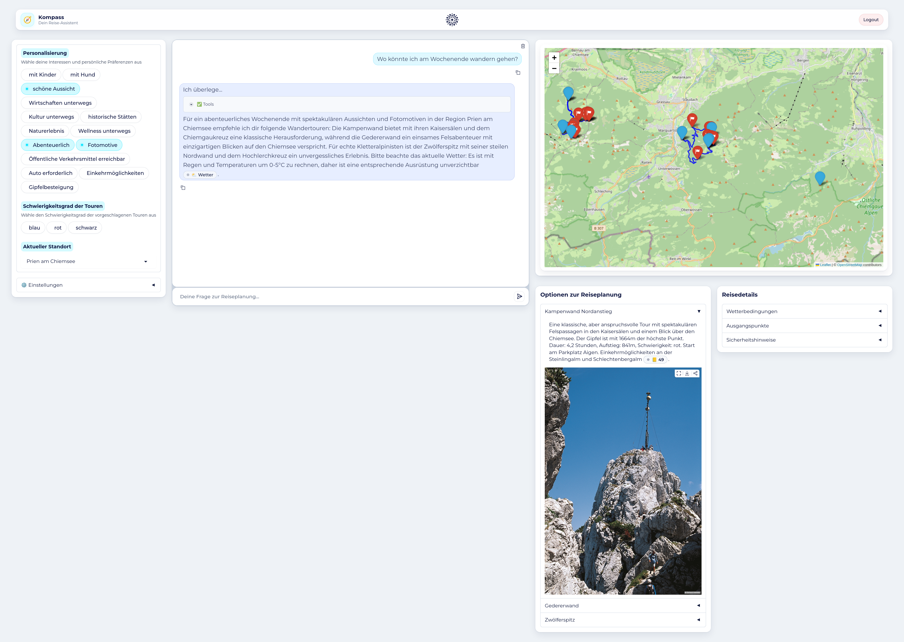

# Agentische KI-Reiseassistenz

> [!IMPORTANT]
> This is a proof-of-concept implementation of an AI-powered travel and hiking assistant. It uses an agentic AI-system with mutliple tools to support the user with their travel and hiking plans.

> [!WARNING]
> Do not expect production-ready code. This is a research prototype to demonstrate the capabilities of LLMs and agentic systems in the context of travel and hiking publishers. Use at your own risk.



## Get started with docker

* Install docker and docker-compose on your platform.
* Install uv: https://docs.astral.sh/uv/getting-started/installation/
* Clone this repository.
* Place your travel and hiking data in the `data/` directory.
* Install the project dependencies: `uv sync`.
* Create the environment file `.env` by copying and editing `env.template`.
* Setup the database: `make db`.
* Build and run the docker image:
```bash
docker compose build
docker compose up -d
```

Now the application is available on `127.0.0.1:8887`.

## Load your own data

We ship this prototype with an example dataset to demonstrate the usage with different datatypes. They are stored in `data/example/`. You can use this as a starting point for your own data.

## Customize the tools

The prototype requires a LLM that can do interleaved thinking/interleaved toolcalling. The available tools can be found in `src/tools/`.
If you want to add tools or customize exisiting tools, add or edit files there. Then import your tool function and add it to the tool registry in `src/tools/registry.py`.
To customize the icons displayed in the thinking log, edit `TOOL_ICONS` in `src/constants.py`.

## Setup local LLMs

We recommend running the application with local models on your machine. A reasoning LLM and an embedding model is required.
See [LLM Howto](LLM-HOWTO.md) for details.

## License

The code of this project is licensed under the MIT License - see the [LICENSE](LICENSE) file for details.
The prototype is intended for use by media companies.

Copyright (c) 2026 Medien.Bayern GmbH.

The repository also contains example data and hiking tours from the [Nationalparks Bayerischer Wald](https://www.nationalpark-bayerischer-wald.bayern.de/besucher/touren_tipps/index.htm). These data in (`data/`) are licensed under [Creative Commons Attribution-ShareAlike 4.0 International (CC BY-SA 4.0)](https://creativecommons.org/licenses/by-sa/4.0/). The data was accessed on 2026-05-06.


## Contributors
Original development by the Medien.Bayern GmbH ([KI.M](https://www.kim-bayern.de/)) in collaboration with [Tobias Sterbak](https://tobiassterbak.com). 

## A project of KI-Kompetenzzentrum Medien (KI.M)
The KI-Kompetenzzentrum Medien (KI.M) is the central hub for artificial intelligence in Bavaria's media industry. We support media companies in adopting AI solutions that are legally compliant, future-proof, and built on data-sovereign infrastructure.

We provide independent information and hands-on demonstrations of AI capabilities and limitations in media applications. Through our AI Lab, we collaborate with partners to test real-world implementations. Our feasibility studies are published as reports on our website, while the technical foundations and code are shared here in our repositories.

The KI.M is a joint initiative of the Bayerische Landeszentrale für neue Medien (BLM) and Medien.Bayern GmbH, supported by the Bavarian State Chancellery.

**Learn more:** [Visit our website](https://www.kim-bayern.de/)


